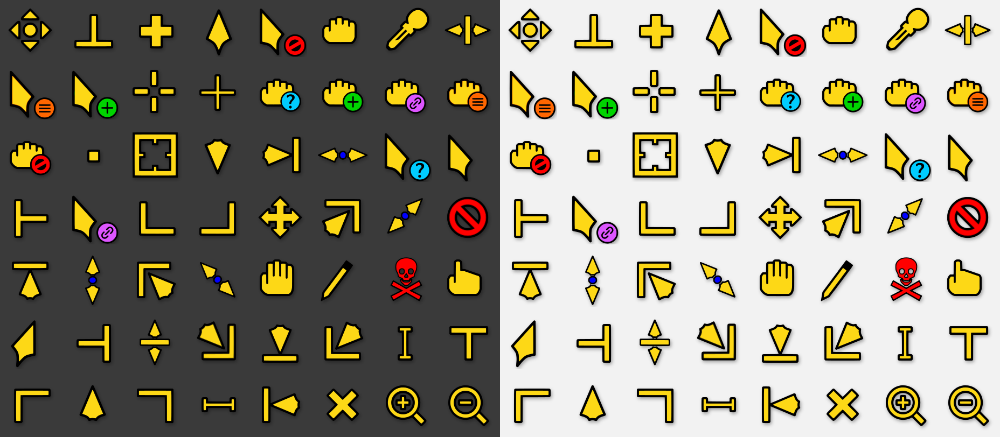
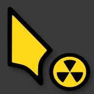

# Radioactive

<p align="center">
	
</p>

Simple cursor theme for the lovers of radioactivity, now with SVG cursors that
work on **GNOME 51**.

This is a fork of [alvatip/radioactive](https://github.com/alvatip/radioactive).
The original Xcursor bitmaps are not supported by GNOME 51, so every cursor has
been re-created as a scalable SVG, traced from the original artwork. The classic
Xcursor files are still included for X11 and older desktops.

## Preview

The scalable cursors on a dark and a light background:



### Busy cursors

The `progress` cursor (arrow with a small spinning radioactive symbol) and the
`wait` cursor (the big spinning radioactive symbol) are the original animations,
traced frame by frame.



The original bitmap cursors are shown in [art/preview.png](./art/preview.png).

## Installation

Clone the repository and run the installer:

```sh
git clone https://github.com/alfurka/radioactive.git
cd radioactive
./install.sh
```

Run it as a regular user to install for yourself only
(`~/.local/share/icons/Radioactive`), or with `sudo ./install.sh` to install for
all users (`/usr/share/icons/Radioactive`). Any previous install of the theme is
replaced.

### Archive installation

Alternatively, extract the archive. It contains a top-level `Radioactive/`
directory.

```sh
mkdir -p "$HOME/.local/share/icons"
tar -xzf archives/Radioactive.tar.gz -C "$HOME/.local/share/icons"
```

For a system-wide installation, use `/usr/share/icons` as the destination.
If you are updating, delete the old `Radioactive` directory first.

### Select the theme

Select **Radioactive** in GNOME Tweaks (or your desktop's settings), or run:

```sh
gsettings set org.gnome.desktop.interface cursor-theme 'Radioactive'
```

If the cursor does not update immediately, log out and back in.

## Uninstallation

Remove `Radioactive` from the directory where it was installed:

```sh
rm -r "$HOME/.local/share/icons/Radioactive"
```

For a system-wide installation, remove `/usr/share/icons/Radioactive` with
administrator privileges (`sudo rm -r /usr/share/icons/Radioactive`).

## What is in the package

- `Radioactive/cursors` - the original Xcursor files (X11 and older desktops).
- `Radioactive/cursors_scalable` - the SVG cursors for GNOME 51 and other
  desktops that load SVG cursor themes. Each cursor is a folder with its SVG
  frame(s) and a `metadata.json` holding the hotspot and animation timing.

The SVGs are traced from the original 96px cursor artwork, so they look like the
originals at any size or display density, and they keep the original hotspots.

### Rebuilding the SVG cursors

```sh
python3 build-scalable-cursors.py
```

Run it from the repository root. It needs Python 3, Pillow, NumPy and the
`potrace` command line tool, and it regenerates `Radioactive/cursors_scalable`
from `Radioactive/cursors`.

## Issues

Problems with the SVG cursors or the installer: please open an issue
[here](https://github.com/alfurka/radioactive/issues).

## Credits

- Cursor design: [alvatip](https://github.com/alvatip), original project at
  [alvatip/radioactive](https://github.com/alvatip/radioactive) (also on
  [Pling](https://www.pling.com/p/1579027/)).
- SVG conversion for GNOME 51: [alfurka](https://github.com/alfurka).
- More from the original author:
  [Nordzy icon theme](https://github.com/alvatip/Nordzy-icon) and
  [Nordzy-cursors](https://github.com/alvatip/Nordzy-cursors).

## Licence

GNU General Public Licence v3.0. See [COPYING](./COPYING).
